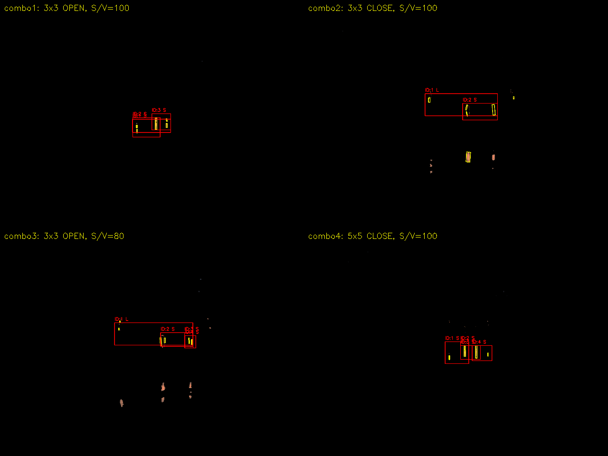

# 06 · 四组 colorSegment 参数对比（3×3/5×5 × OPEN/CLOSE × 阈值）

- **版本**：临时参数实验，基线为 `208713b`；实验后代码已还原到该提交（3×3 OPEN，S/V=100）
- **每组都重新 `catkin_make`**，并在 `rosbag play bag/red_4.bag --clock -l` 播放时重新启动节点抓帧

## 参数表

| 组合 | Kernel | 操作 | HSV 红色下限 (S,V) |
|---|---|---|---|
| C1 小而严 | 3×3 | `MORPH_OPEN` | 100（原样） |
| C2 小而缝合 | 3×3 | `MORPH_CLOSE` | 100（原样） |
| C3 宽容吸光 | 3×3 | `MORPH_OPEN` | **80** |
| C4 大刀阔斧 | 5×5 | `MORPH_CLOSE` | 100（原样） |

## 运行结果（每组单独编译、单独起 bag + 节点）

| 组合 | 编译 | `ok` 打印 | 图像频率 | 崩溃 | 抓帧中心区像素 | 中心外像素 | 中心外杂散块 |
|---|---|---|---|---|---|---|---|
| C1 | 通过 | 持续 | 49.5 Hz | 无 | 5720 | 596 | 1 |
| C2 | 通过 | 持续 | 50.4 Hz | 无 | 7473 | 646 | 2 |
| C3 | 通过 | 持续 | 47.9 Hz | 无 | 8502 | 1190 | 6 |
| C4 | 通过 | 持续 | 50.5 Hz | 无 | 6112 | 615 | 1 |

四组均未崩溃、未出现 `cv::Exception`，所以没有跳过项。

## 同一批原始帧的离线对比（20 帧，完全相同的输入，只改参数）

| 组合 | 合格灯条 | 断裂组 | 噪点轮廓 | 中心区像素 | 中心外像素 |
|---|---|---|---|---|---|
| C1 3×3 OPEN 100 | 29 | 2 | **161** | 11716 | **2078** |
| C2 3×3 CLOSE 100 | 38 | 0 | 693 | 15401 | 3676 |
| C3 3×3 OPEN 80 | 34 | 0 | 245 | **16615** | 2875 |
| C4 5×5 CLOSE 100 | 41 | 0 | 629 | 16076 | 3826 |

解释：
- `CLOSE` 能消掉断裂（frag=0），但会**把相邻噪点缝成块**，噪点轮廓数从 161 涨到 629~693。
- C3 降低阈值后信号最多（16615），代价是再把噪点抬高（245）且画面里出现跨大间隔的假配对。
- C1 噪点最少（161 / 2078），但保留 2 处断裂。

## 画面截图（每组取“画面正中刚好有灯条”的一帧）

- `combo1.png`：3 根灯条、2 个红框，周围杂散点最少
- `combo2.png`：`ID:1 L` 大框跨越大间隔，底部出现把噪点当灯条的假黄框
- `combo3.png`：`ID:1 L` 明显跨间隔假配对，底部噪点色块最多
- `combo4.png`：4 个红框相互重叠，检测到的灯条最少（4 根）

## 结论

- **画面最干净：C1（3×3 + OPEN + 原阈值）** —— 中心外像素 596、杂散块 1 个，红框 3 个，没有把噪点当灯条。
- C2/C4 的“缝合”确实消除了断裂，但代价是假目标增多（C2 出现跨间隔大框、底部假灯条）。
- C3 最灵敏，但也是最吵的一组，不适合直接交画面。
- 若要“既不断裂又干净”，应在 C1 上做**同 x 范围内上下轮廓合并**，而不是靠 CLOSE 或降阈值。
