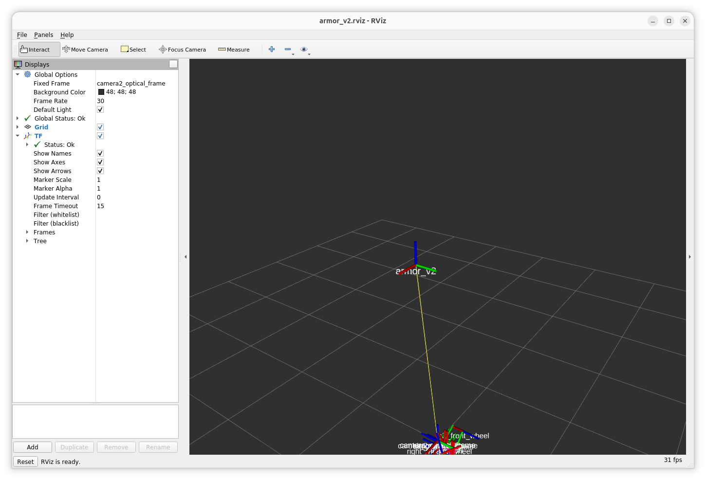
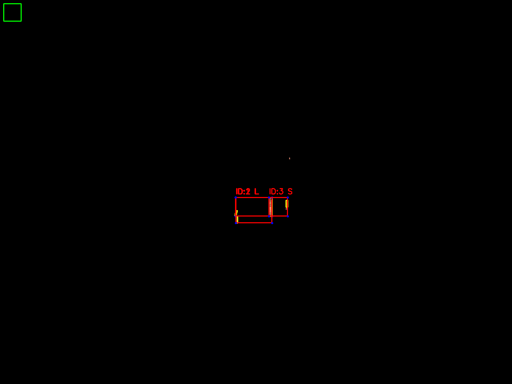

# 07 · v2 升级：抗眩光 / 残缺 / 抖动

- **版本**：新增 `src/detection_node_v2.cpp`（**未改动** v1 `detection_node.cpp`）
- **新增编译目标**：`detect_node_v2`（CMakeLists 追加，v1 `detect_node` 照常编译）
- **新增 launch**：`launch/test_v2.launch`
- **新增 RViz 配置**：`rviz/armor_v2.rviz`
- **新增依赖**：`tf2_ros`、`geometry_msgs`

## 4 项核心优化的实现位置

| 优化 | 实现 |
|---|---|
| 1. 抗眩光中心点 | `cv::moments(contour)` → `m10/m00, m01/m00` 作为 `Bar.center`，排序/配对/相对位置全用它，不用 `minAreaRect.center` |
| 2. 倾斜透视补偿 + S/L | `tilt = atan2(long.x, long.y)`；`corrected = dx / |cos(avg_tilt)|`；`ratio = corrected / max(long_h)`；`0.5~1.3 → S`，`1.3~2.5 → L`，超出拒绝 |
| 3. 极值中点修正 | 取两灯条轮廓的 `min/max x,y`，构造 `TL/TR/BR/BL` 横平竖直 4 角点（图中蓝点） |
| 4. PnP + 平滑 + TF | `solvePnP(IPPE→ITERATIVE 回退)`；长度 5 队列，权重 1..5 加权平均；`t = (x, -y, z)`；广播 `hk_camera_ca → armor_v2` |

## 编译与运行

```bash
catkin_make                      # BUILD EXIT: 0，Built target detect_node_v2
rosbag play bag/red_4.bag --clock -l
rosrun final_text detect_node_v2 # 或 roslaunch final_text test_v2.launch
```

| 检查项 | 结果 |
|---|---|
| 编译 | 通过，v1 `detect_node` 同时保留可用 |
| `ok` 打印 | 持续 |
| `/ft/debug/image_v2` | 约 32~36 Hz |
| 崩溃/异常 | 0 |

## TF 验证

```bash
rosrun tf tf_echo hk_camera_ca armor_v2
# Translation: [-0.187, -0.033, 2.376]
# Rotation: RPY [0.000, -0.000, 0.022] (yaw 1.25 deg)
```

多次采样：`xyz ≈ (0.02~0.48, -0.03~0.02, 1.6~2.7)`，`yaw ≈ ±1°`，队列平滑后无跳变。

RViz（`rviz -d rviz/armor_v2.rviz`）：
- `Global Status: Ok`，`TF Status: Ok`
- 能看到 `armor_v2` 坐标系挂在 `camera2_optical_frame` 下





## 注意事项（重要）

1. **同一帧只对第一个目标广播 TF**：多目标写同一个 `armor_v2` 会触发
   `TF_REPEATED_DATA`，所以 PnP/TF 只对 `armor_id==1` 执行，其余目标只画框。
2. **`hk_camera_ca` 不在 bag 的 TF 树里**：RViz 里临时加了
   `static_transform_publisher 0 0 0 0 0 0 camera2_optical_frame hk_camera_ca` 做连接，
   仅用于可视化，不是代码逻辑。
3. **PnP 位姿仍是光学系**：按需求只做了 `y = -y`。光学系 Z 是深度，因此 RViz 里
   armor 会出现在 +Z 方向（网格上方），而不是 ROS 车体系的 +X 前方。
   若要严格 ROS 右手系，需要整体旋转 `(x,y,z)_opt → (z, -x, -y)_ros`。
4. **S/L 判定偏 L**：实测 `ratio` 多在 1.4~2.3，小装甲板容易被判成 L，
   后续需要按实际装甲板像素尺寸/焦距重新标定 `long_h` 或阈值区间。
5. 队列平滑为全局单队列（服务第一个目标），多目标场景如需独立平滑要按 ID 分队列。
