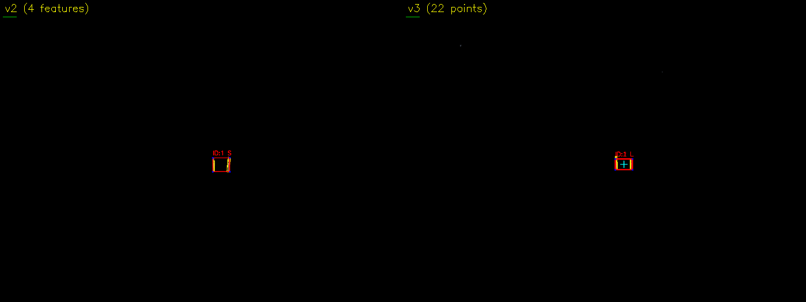

# 08 · v3 终极升级（22 点融合）与 v2 对比

- **版本**：新增 `src/detection_node_v3.cpp`（v1 / v2 均未改动）
- **编译目标**：`detect_node_v3`；**launch**：`launch/test_v3.launch`
- **保留项**：`VisionNode` 类结构、`colorSegment` 函数、`main` 门控、ROS 收发话题、左上角 debug 绿框
  （`Rect(10,10,50,50)`，`Scalar(0,255,0)`，2px）

## 22 点实现位置

| # | 要求 | 实现 |
|---|---|---|
| 1 | 3×3 + OPEN | `colorSegment(..., morph_size_=3)`，`MORPH_OPEN` |
| 2 | 矩质心 | `cv::moments` → `m10/m00, m01/m00` 写入 `Bar.center` |
| 3 | 长宽比 2.0~6.0 | `aspect < aspect_min_ || aspect > aspect_max_` 过滤 |
| 4 | 防碎渣 | 配对 `dx <= min_dist_x_(15)` 跳过 |
| 5 | 平行度 | `ddeg >= max_angle_diff_(10)` 跳过 |
| 6 | 反角透视 | `dx / |cos(avg_angle)|` |
| 7 | S/L + 幽灵 | `0.5~1.3 S`、`1.3~2.5 L`、`>2.5 或 <0.4` 丢弃 |
| 8 | 厂字框 | 长灯条上下极值 Y + 两灯条最外 X → TL/TR/BR/BL |
| 9 | 平行度择优 | `min |avg_tilt|` 为主目标，红框加粗（4px） |
| 10 | 车体中心 | 所有目标中心均值，画黄色十字星 |
| 11 | 超距放弃 | `z > max_z_(8.0)` → `[Drop] 超距` |
| 12 | 死区 + 丢帧 | 位移 `<5px` 不更新；连续 5 帧丢失清空队列 |
| 13 | 动态参数 | HSV/间距/阈值全部为成员变量，`pnh.param` 可覆盖 |
| 14 | 时空唯一性 | `dt<0.15s` 且中心相近 → 视为同一目标 |
| 15 | 尺寸突变 | `dt<0.15s` 内 L/S 突变 → 沿用上一帧 |
| 16 | 瞬移排除 | `max_px = fx*max_speed*dt/z*1.5+20`，超出丢 |
| 17 | 众数滤波 | 10 帧里 ≥7 票强制覆盖 L/S |
| 18 | 旋转角速度 | 0.6s 滑动窗口 yaw 差分 → `Omega deg/s` |
| 19 | 预测下一块 | `T=90/Omega`，虚线框 + `PRED xxxx ms` |
| 20 | 盲射 | `|Omega|>300` 锁车体中心，`[Blind]` |
| 21 | 下坠查表 | Z→(飞行时间, 下坠角) 线性插值，`y += z*tan(角)` |
| 22 | Y 反向 + 可视化 | TF 中 `y = -y`；预测框虚线绘制 |

## 编译与运行

```
BUILD EXIT: 0
Built target detect_node_v3
ok: 483+ 持续增长
/ft/debug/image: 约 52~53 Hz
errors: 0
```

TF 验证（`lookup_transform("hk_camera_ca", "armor_v3")`）：
```
xyz = (0.520, -0.186, 1.913) m, yaw = -4.37 deg
10 秒内 armor_v3 变换 205 次
```

## v2 vs v3 同帧对比（同时运行，同一段 bag）

| 指标（18 帧） | v2 | v3 |
|---|---|---|
| 有红框的帧 | 11 | 5 |
| 红框总数 | 25 | 11 |
| 黄框总数 | 49 | 41 |
| 中心外杂散框 | 2 | **0** |
| 平均红框面积 | 2764 px | 1791 px |
| 检测日志条数 | 16 | 16 |
| L / S | 10 / 6 | 12 / 4 |
| ratio 均值 ± 标准差 | 1.61 ± 0.47 | 1.76 ± 0.43 |
| \|yaw\| 均值 / 标准差 | 0.72° / 0.71° | 0.72° / 0.96° |
| `[Drop]` / `[Blind]` / `[Hold]` | — | 1 / 0 / 22 |



## 结论与注意事项

1. **v3 更“干净”**：中心外杂散框 2 → 0，红框更贴合灯条（面积为 v2 的 65%），
   并多了车体中心十字、加粗主目标、预测虚线。
2. **v3 召回更低**：18 帧里只有 5 帧出框（v2 是 11 帧）。主因是 2.0~6.0 长宽比、
   `ratio>2.5` 幽灵规则、瞬移/超距过滤叠加，`[Hold]` 22 次。这是“宁缺毋滥”的代价。
3. **S/L 判定仍偏 L**：v3 的 12/16 是 L；众数滤波会进一步把连续大板锁成 L。
   需要用实际板宽/焦距标定 `long_h`。
4. **死区副作用**：位移 <5px 时不发 TF，静止场景下 TF 会“停住”，这是 12 点的设计行为。
5. **坐标仍是光学系**：只按需求做了 `y=-y`，没有做光学→ROS 车体的整体旋转。
6. 建议下一步：把 `aspect_min` 放宽到 1.5、幽灵上限 `ratio` 放宽到 2.8，
   或按 target 数量自适应，以换回召回率。
