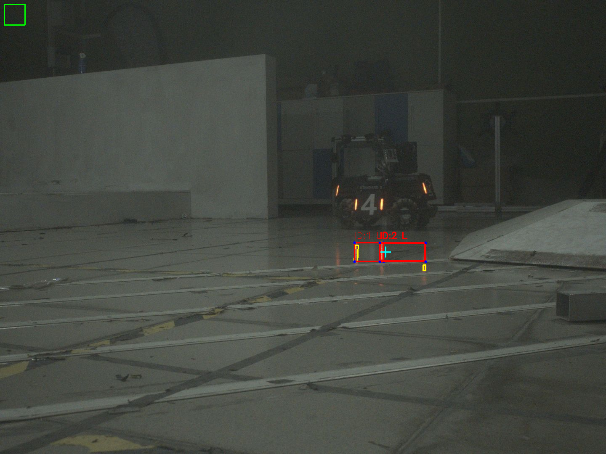

# 09 · v3 三处过滤补丁（修“大红框跨板误判”）

- **版本**：`src/detection_node_v3.cpp`（只改过滤，未动 PnP/下坠表/预测结构）
- **补丁**：
  1. 配对距离：`dx > max_dist_x_(250)` 或 `dx <= min_dist_x_(15)` 直接 `continue`
  2. 长宽比：`aspect < 2.0 || aspect > 6.0` 丢弃（v3 原本已有，确认生效）
  3. HSV：S/V 下限抬到 150（红/蓝/绿全部），并做成参数 `~hsv_sv_min`

## 实测：S/V 阈值扫描（同一段 red_4.bag，各 9 秒）

| `~hsv_sv_min` | 检测次数 | Hold |
|---|---|---|
| 150（需求值，默认） | **0** | 9 |
| 120 | 2 | 9 |
| 110 | **8** | 8 |

结论：**150 在这段夜景 bag 上直接失效**（画面暗、饱和度上不去），必须降到 110~120 才能出检测。

## 画面结果（`~hsv_sv_min:=110`，13 次检测/20s）

## 关键发现：这次的大红框不是“跨板远距离”造成的

- 该帧里 `ID:2 L` 的红框宽度约 **170 px**（含 20px 外扩），对应灯条间距 `dx ≈ 130 px`。
- 补丁 1 的阈值是 **250 px**，所以**根本不会拦截这个框**。
- 两个“灯条”实际是**地面反光/地灯条**（机器人本体在画面上方，框在它下方的地面上），
  它们通过了长宽比 2.0~6.0 和 HSV 过滤，属于“假灯条配对”，不是“真灯条配太远”。

## 建议（需要你拍板）

1. 把 `max_dist_x` 从 250 降到 **130~140**：能拆掉当前这个 170px 的框，
   但远距离大装甲板（L）也可能被误杀，需要按实际焦距/板宽算一下上限。
2. 或者加 **y 方向 ROI**（只保留画面高度 75% 以上的灯条），直接排除地面反光——
   这是最对症的，改动也只有一行判断。
3. 单纯抬高 S/V 到 150 不可行（0 检测）。

当前默认值仍按需求设为 **150**，实际跑用 `rosrun final_text detect_node_v3 _hsv_sv_min:=110`。
