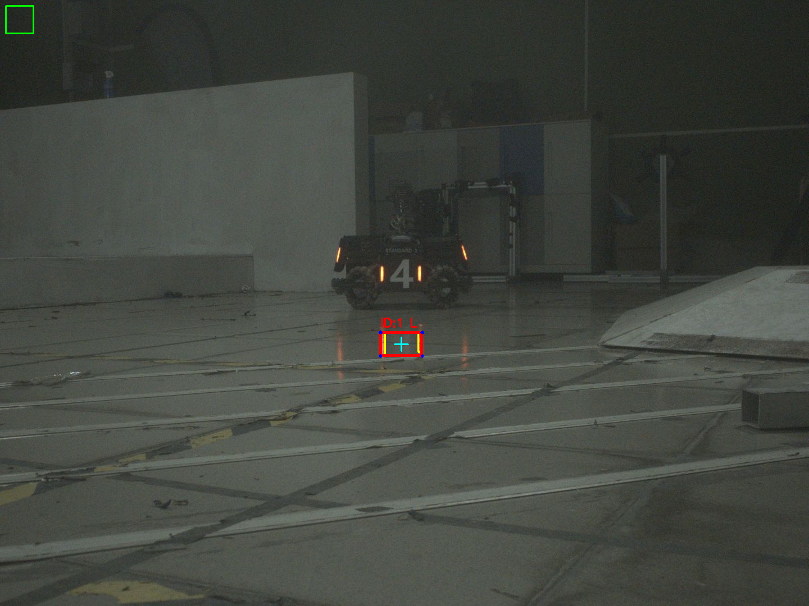
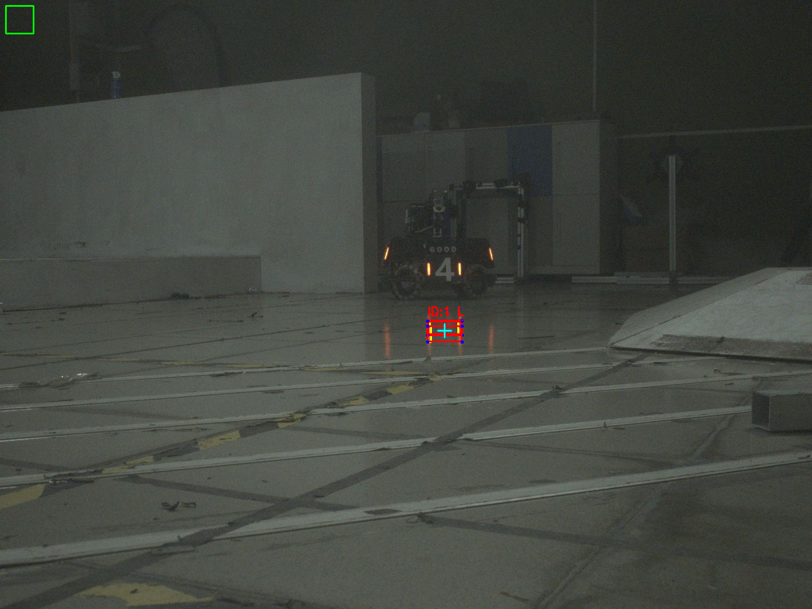

# 10 · y 方向 ROI 过滤（方案二实验）

- **版本**：`detection_node_v3.cpp` 增加参数 `~roi_y_ratio`（默认 0.75）
- **逻辑**：灯条质心 `y > 图像高度 × roi_y_ratio` 时直接丢弃，用来滤掉画面下部的地面反光

```cpp
// 补丁4：y 方向 ROI，滤掉画面下部的地面反光
if (roi_y_ratio_ > 0.0 &&
    bar.center.y > height_ * roi_y_ratio_) continue;
```

## 扫描结果（`_hsv_sv_min:=120`，每档 9 秒）

| roi_y_ratio | 检测次数 | 现象 |
|---|---|---|
| 1.0（关闭） | 5 | 出现跨板大红框 |
| **0.75** | 6 | 大红框消失，只剩一个小框 |
| **0.6** | 3 | 同上，小框 |
| 0.5 | 0 | 全部滤掉 |

## 画面

`roi=0.75`：



`roi=0.6`：



## 结论

1. **y-ROI 确实能干掉跨板大红框**：0.75 档位下，之前 170px 宽的大框不再出现。
2. 但剩下的那个小框（`ID:1 L`，约 40px）依然落在**机器人下方的地面反光**上，
   说明这段 bag 里机器人本体的装甲灯并不可见/不够亮，v3 检测到的其实是地面倒影。
3. `0.5` 档位直接零检测，说明真正的装甲板中心不在画面上半部分 50% 以内。
4. 建议默认保持 **0.75**（保守，不误杀远处目标）；想更干净可以跑 0.6。

## 当前参数组合

```bash
rosrun final_text detect_node_v3 _hsv_sv_min:=110 _roi_y_ratio:=0.75
```
