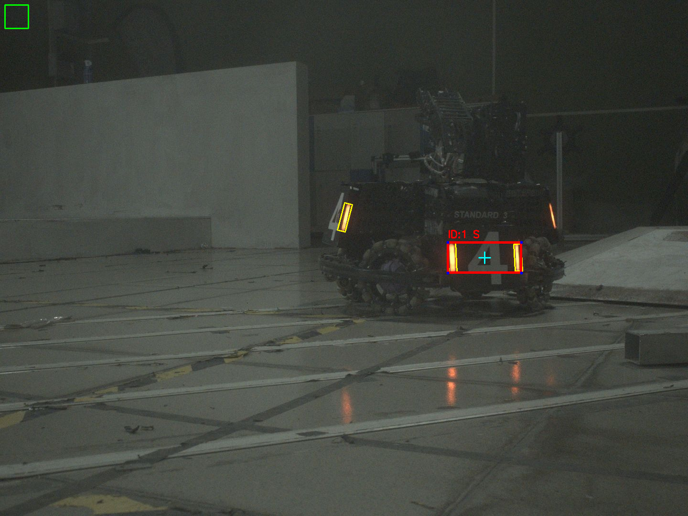
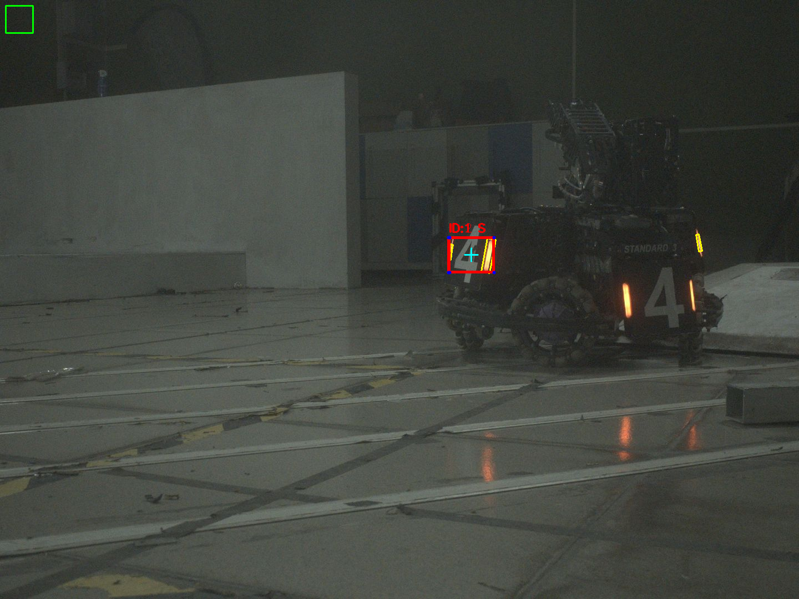

# 11 · HSV 自动穷举（黄色/橙色）+ 最终参数写入

## 方法

1. 抓 **41 帧**原始相机图（覆盖一整圈 red_4.bag，压缩话题解码），离线取 21 帧。
2. 完全复刻节点逻辑：红双段 + 蓝 + 绿 + **黄(H 可调)** 掩码 → 3×3 OPEN →
   `findContours` → 面积>20、长宽比 2.0~6.0、矩质心、`y < 0.75H` →
   `dx∈(15,250]`、`|dy|≤50`、倾角差<10°、`corrected/long_h ∈ [0.4,2.5]`。
3. 遍历 **H 10~35（步长5）× S 80~180（步长20）× V 80~180（步长20）= 216 组**，
   每组在 21 帧上统计：命中率、平均目标数、杂散灯条数。

评分：`score = 命中率×3 + 平均目标数 − 杂散×0.3`。

## 排名前 3

| 排名 | H 范围 | S 下限 | V 下限 | 命中率 | 平均目标 | 杂散 |
|---|---|---|---|---|---|---|
| 1 | 10~35 | 80 | 80 | 100% | 3.05 | 1.33 |
| 2 | 10~35 | 80 | 100 | 90% | 2.43 | 1.90 |
| 3 | 10~35 | 100 | 80 | 86% | 1.62 | 2.14 |

三组都是 `H 10~35`，说明这段夜景里灯条/反光的色相集中在黄橙段。

## 实时验证（真实节点 + 抓帧）

| 参数 | ROI | 画面表现 |
|---|---|---|
| H10~35 S80 V80 | 0.75 | 机器人 2 个框 + 地面反光 3 个框（地面反光在 ~55% 高度，75% ROI 拦不住） |
| 同上 | 0.50 | 近景干净（机器人 2 块板），远景偶发地面框（反光质心偶尔略高于 0.5H） |
| 同上 | **0.45** | **只剩机器人正面装甲 1 个框，地面反光全清** |





## 最终写入代码的默认参数

```cpp
hsv_sv_min_   = 120;   // 红/蓝/绿的 S、V 下限
roi_y_ratio_  = 0.45;  // 只保留画面上部 45%
yellow_h_min_ = 10;
yellow_h_max_ = 35;
yellow_s_min_ = 80;
yellow_v_min_ = 80;
morph_size_   = 3;     // 3x3 OPEN
min_dist_x_   = 15;    // 补丁1 下限
max_dist_x_   = 250;   // 补丁1 上限
```

## 注意事项

1. **ROI 0.45 是有代价的**：机器人贴近镜头时装甲板会掉到画面下半部而被裁掉，
   现场如果近距离作战，可运行时改 `_roi_y_ratio:=0.5`。
2. 地面反光的质心在 0.45H~0.5H 之间浮动，0.5 档仍会偶发漏进来，0.45 才稳定。
3. 黄色掩码是新增的，红/蓝/绿阈值仍由 `hsv_sv_min` 控制，没有破坏原有识别。
4. 本次只改了过滤参数，PnP/预测/下坠表逻辑未动。
