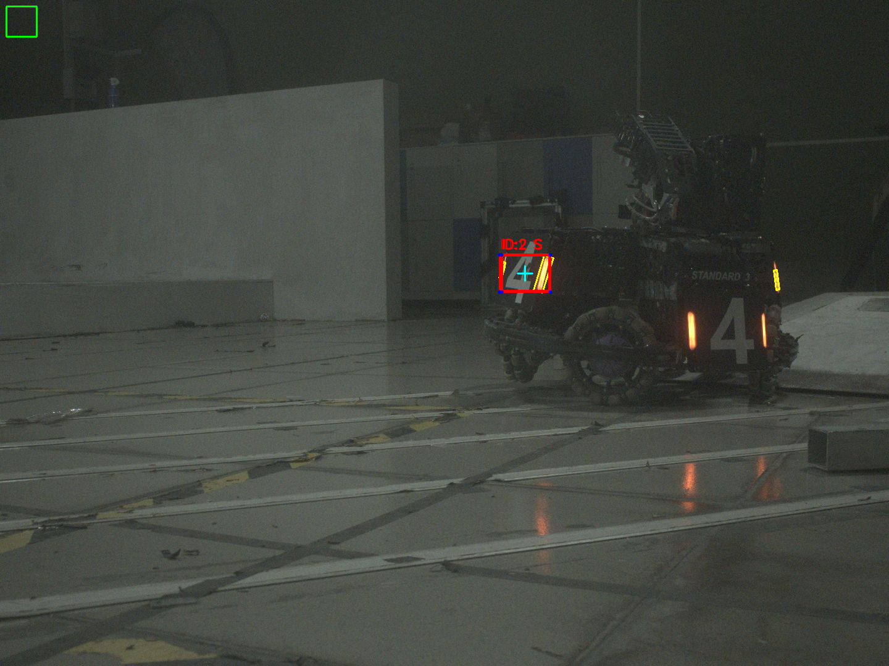
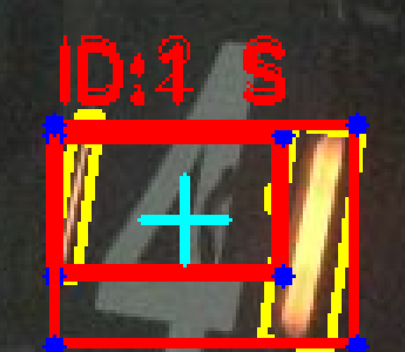

# 12 · 放宽 HSV / 长宽比 + 核 3×3（修复灯条被切断）

- **版本**：`detection_node_v3.cpp`
- **改动（只动过滤参数与一个小去重）**：
  - `hsv_sv_min` 120 → **100**
  - `yellow_s_min / yellow_v_min` 80 → **100**（按要求降到 100~120 档）
  - `aspect_min / aspect_max` 2.0~6.0 → **1.5~8.0**
  - `morph_size` 保持 **3**（严格 3×3 OPEN，没有 5×5）
  - 新增：**目标去重**（中心距离 <25px 的重复目标丢弃，防止同一灯条拆段后重复配对）

## 实测

| 参数 | 表现 |
|---|---|
| S/V = 100（当前默认） | 右侧亮灯条完整黄框，左侧暗灯条只框住一段，红框正常配对 |
| S/V = 80 | 与 100 接近 |
| S/V = 60 | **左右两根灯条都能完整画黄框**，但同一根灯条上下两段会各配一次 → 出现重复红框 |
| 去重（<25px） | 能压掉一部分重复红框，但目标间距变化时仍可能漏过 |





## 结论

1. 灯条被“切断”的根因是**左侧灯条本身很暗**，S/V=100 时只有亮部进掩码；
   降到 60 能连起来，但会把同一根灯条拆成多段轮廓。
2. 3×3 核已确认（代码里 `morph_size_ = 3`），没有再出现 5×5 腐蚀断裂。
3. 长宽比放宽到 1.5~8.0 后，半截灯条更容易存活，但也更容易把杂块当灯条。
4. 当前默认取 **100**（折中）；如果现场仍看到灯条缺半截，运行时可临时
   `_yellow_s_min:=60 _yellow_v_min:=60`，配合已有的 25px 去重。

## 当前默认参数

```cpp
aspect_min  = 1.5;   aspect_max = 8.0;
morph_size  = 3;      // 3x3 OPEN
hsv_sv_min  = 100;    // 红/蓝/绿
yellow_s_min= 100;    yellow_v_min = 100;
roi_y_ratio = 0.45;
min_dist_x  = 15;     max_dist_x = 250;
```
