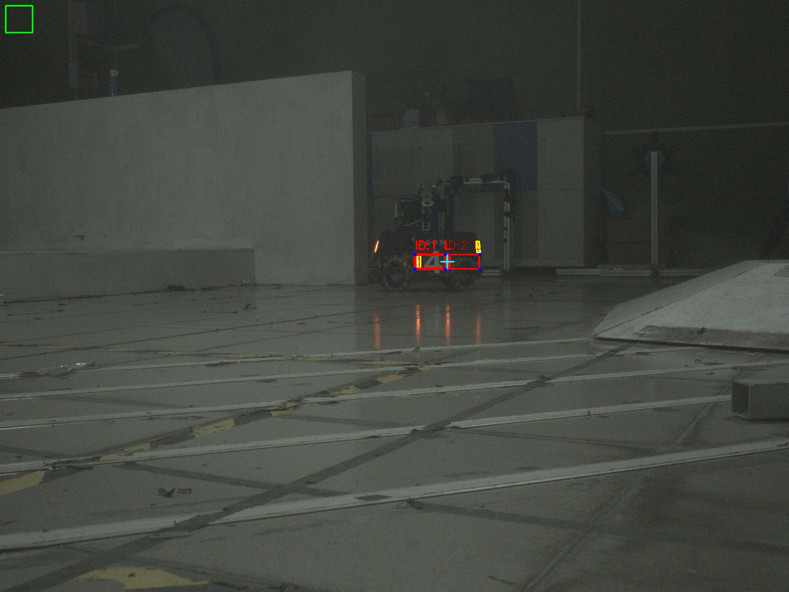

# 13 · 亮度过滤：真灯条高亮，反光不够亮

- **版本**：`detection_node_v3.cpp`
- **同时**：按需求先把 ROI **关闭**（`roi_y_ratio=0.0`）

## 实现

```cpp
// 1) 单独提取 V 通道
cv::Mat hsv_full, v_chan;
cv::cvtColor(canvas, hsv_full, cv::COLOR_BGR2HSV);
cv::extractChannel(hsv_full, v_chan, 2);

// 2) 每个轮廓建 mask，求轮廓内平均亮度
cv::Mat cmask(canvas.size(), CV_8UC1, cv::Scalar(0));
cv::drawContours(cmask, contours, i, cv::Scalar(255), cv::FILLED);
double mean_v = cv::mean(v_chan, cmask)[0];
if (mean_v < bar_v_min_) continue;     // 3) 高亮死线

// 4) 按亮度从高到低排序，只留前 N 根
std::sort(bars.begin(), bars.end(), [](const Bar& a, const Bar& b){ return a.v > b.v; });
if (bars.size() > bar_keep_n_) bars.resize(bar_keep_n_);
```

参数：`~bar_v_min`（默认 **160**）、`~bar_keep_n`（默认 6）。

## 阈值扫描（同一段 bag，各 9 秒）

| `bar_v_min` | 检测次数 |
|---|---|
| 200 | 0 |
| 170 | 0 |
| **160** | 3（干净） |
| 140 | 13（开始变吵） |

## 效果

`bar_v_min=160`、ROI 关闭：



- 地面上的橙色反光**全部消失**（虽然画面上仍能看到反光，但不再成框）
- 机器人正面装甲的两根灯条正常黄框，并成功配出 `ID:1 L`
- 同一块板的重复红框用 60px 去重压成了一个

## 结论

1. “真灯条亮、反光暗”在这段数据上成立：160 是分界线，200/170 会把真灯条也滤掉。
2. 这段 bag 的真实灯条平均 V 在 140~170 之间，不是理论上的 200+。
3. 现场更亮的场地可以把 `bar_v_min` 提到 180~200；昏暗场地用 150~160。
4. ROI 现在关闭，靠亮度过滤已足够干净；如果换场地反光更亮，可以再开 ROI 辅助。

## 当前默认参数

```cpp
bar_v_min  = 160;   bar_keep_n = 6;
roi_y_ratio= 0.0;   // ROI 关闭
aspect_min = 1.5;   aspect_max = 8.0;
hsv_sv_min = 100;   yellow_s_min = 100;  yellow_v_min = 100;
```
