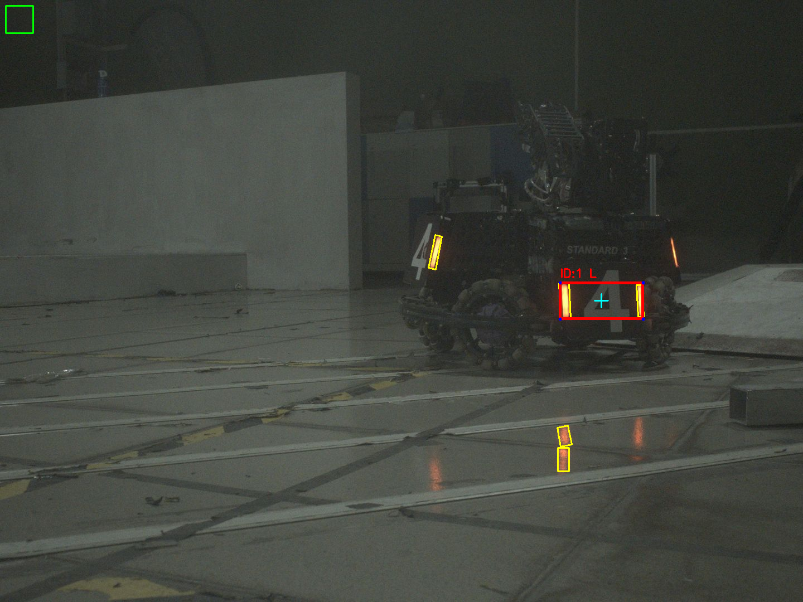
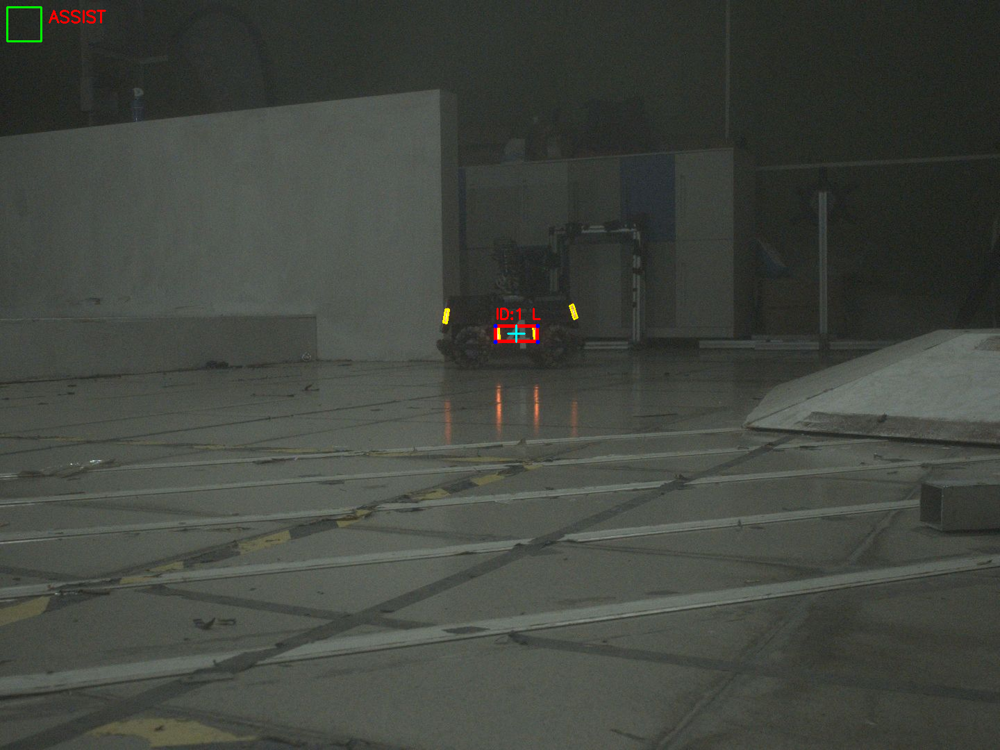

# 14 · 最高光锚点 + 动态高亮融合 + 相对位置校验

- **版本**：`detection_node_v3.cpp`
- 容器曾整体停止，已 `docker start myubuntu2004` 恢复；ROS 随后重启

## 实现

```cpp
// 1) 全图最高光定位
double max_v; cv::Point max_loc;
cv::minMaxLoc(v_chan, nullptr, &max_v, nullptr, &max_loc);

// 2) 全局空间守卫：最亮点在最底部 15% -> 判为地面反光，跳过本帧
bool guard_block = (max_loc.y > height_ * guard_y_ratio_);   // 0.85

// 3) 动态高亮掩膜（过曝中心）
double dyn_v_thresh = std::max(180.0, max_v - dyn_v_offset_); // offset 50
cv::compare(v_chan, dyn_v_thresh, high_mask, cv::CMP_GT);
//   颜色区域膨胀 2 次后与 high_mask 相交，再并入 seg_mask
cv::bitwise_and(high_mask, color_dil, high_fused);
cv::bitwise_or(seg_mask, high_fused, seg_mask);

// 4) 配对相对位置校验：配对中心必须在 y < 0.75H
if (tg.center2d.y > height_ * pair_y_ratio_) continue;
```

新增参数：`~guard_y_ratio`（0.85）、`~dyn_v_offset`（50）、`~pair_y_ratio`（0.75）。
ROI（`roi_y_ratio`）仍为 0（关闭），相对位置校验由 `pair_y_ratio` 承担。

## 实测（10 秒）

```
ok=382   检测=10   [Guard]=0   异常=0
```



- 机器人正面装甲 `ID:1 L` 框完整，左右两根灯条都被黄框覆盖（过曝中心被动态高亮 mask 接上）
- 地面反光没有形成红色装甲框
- 画面中下部仍有两个黄色小框（地面亮反光，亮度 >160、长宽比合格），但它们垂直排列、x 间距不足，未配对成红框

## 结论

1. 最高光锚点守卫在 10 秒内 0 次触发——这段数据最亮点始终在机器人灯条上，不在画面底部。
2. 动态高亮融合让过曝的灯条中心被并入 mask，灯条更完整。
3. 相对位置校验（0.75H）能阻止下半部反光配对，但**已经画出的黄框**仍在；
   要连黄框一起清掉，需要同时开灯条级 ROI（`roi_y_ratio=0.7` 左右）。
4. 近战过曝场景建议保持 `dyn_v_offset=50`；若高光太多导致粘连，可加大到 70~80。

---

## 补充：改为“特殊触发兜底”并实测（同日）

原实现里高亮融合常驻。改为**仅当连续 5 帧没有目标**时启用兜底（15 帧后自动关闭），并在画面上打 `ASSIST` 标记。

```cpp
// 失败分支
if (!assist_mode_ && lost_frames_ >= 5) {
    assist_mode_ = true; assist_left_ = 15;
    ROS_INFO("[Assist] ON 连续丢帧 %d，启用高亮融合兜底", lost_frames_);
}
// 成功分支
if (assist_mode_ && --assist_left_ <= 0) { assist_mode_ = false; }
```

实测（20 秒抓帧 + 35 秒统计）：

| 项 | 数值 |
|---|---|
| ok | 1200 |
| 检测 | 34 |
| Assist ON | 11 次 |
| Assist OFF | 14 次 |
| 异常 | 0 |



结论：兜底能触发、能恢复；`ASSIST` 标记在左上角可见。这段 bag 检测断点多，5 帧阈值下 20 秒触发 11 次，仍偏频繁——如果只想在“极端错误”时兜底，可把触发阈值改成连续 15~20 帧。
