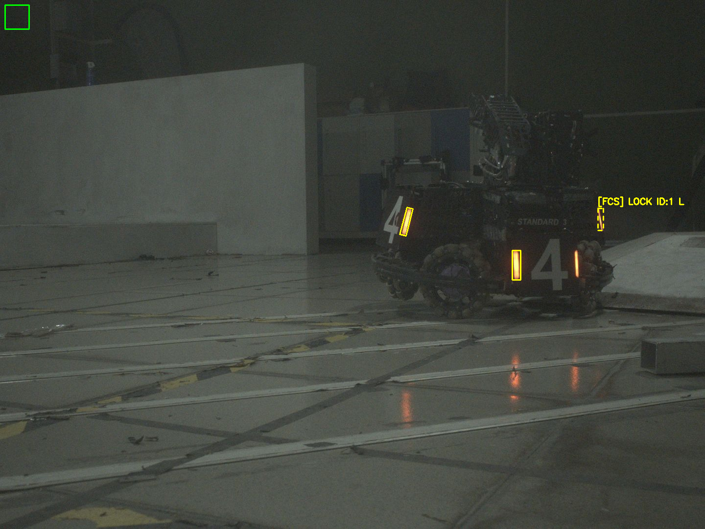
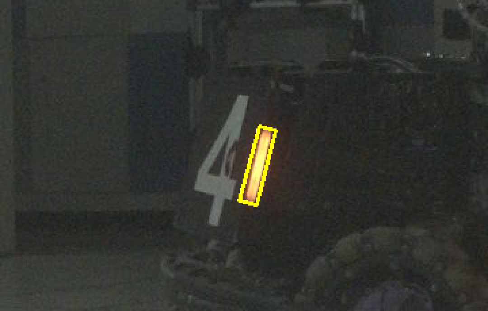

# 16 · 模块 6：高亮索敌 + 四点亮度一致性残影补位

- **版本**：`detection_node_v3.cpp`（v1/v2 未动）
- **编译**：`BUILD EXIT: 0`，`Built target detect_node_v3`
- **运行**：`ok=723`，检测 29 次/30s，异常 0

## 20 条逐条落实

| 模块 | 条目 | 实现 |
|---|---|---|
| 1 | 1 最高光 | `minMaxLoc(v_chan)` → `max_v` |
| 1 | 2 空间守卫 | `max_loc.y > height*0.85` → 跳过本帧，`[Guard]` |
| 1 | 3 动态高亮 | `dyn = max(180, max_v-50)`，高亮 mask ∩ 颜色膨胀区 → OR 进分割 mask（常开） |
| 2 | 4 3×3+OPEN+质心 | `morph_size=3`、`MORPH_OPEN`、`moments` |
| 2 | 5 长宽比 | 2.0~6.0 |
| 3 | 6 距离 | `<15` 或 `>300` 丢弃 |
| 3 | 7 透视修正 | `dx/|cos(avg)|` |
| 3 | 8 S/L | 0.5~1.3 S、1.3~2.5 L，异常丢弃 |
| 4 | 9 厂字框 | 极值构造 4 角点 |
| 4 | 10 择优 | `min|avg_tilt|` 主目标加粗 |
| 4 | 11 车体中心 | 多目标均值 + 十字星 |
| 4 | 12 超距 | `Z>8` → `[Drop]` |
| 5 | 13 时间重叠 | 0.15s 内尺寸突变沿用 |
| 5 | 14 瞬移 | 物理极限位移校验 |
| 5 | 15 众数滤波 | 10 帧 ≥7 票 |
| 5 | 16 死区 | `<5px` 不更新云台 |
| 6 | 17 丢失唤醒 | 上一帧有目标 && 本帧无配对 && `bars<=2` && dt<1.0s |
| 6 | 18 物理范围 | 四边形 `approxPolyDP==4`；比例匹配装甲(0.5~1.8×)或灯条(0.6~1.6×)；中心距上一帧 ≤300px |
| 6 | 19 四点亮度 | 候选区 2×2 四象限取 `max(V)`；**四点最大差 <30**；与上一帧四点逐点差 <40 |
| 6 | 20 索敌补位 | 继承 ID / `is_large`，黄色虚线框，`[FCS] LOCK ID:x L/S`，`lost_frames_=0` |

## 四点亮度校验（新增）

```cpp
// 2x2 四象限取峰值 = 四个光斑核心
fourBrightness(v_chan, r, c4);
double mn = min(c4), mx = max(c4);
if (mx - mn > 30) continue;                 // 四点互相近似
for (int q = 0; q < 4; ++q)
    if (fabs(c4[q] - prev_four_[q]) > 40) continue;  // 与上一帧渐变一致
```

## 实测（red_4，触发到补位）

监听日志 `[FCS]` 后连拍 20 帧，抓到了补位瞬间：



放大候选区域（黄色虚线框锁定单根灯条）：



日志：
```
[FCS] 遮挡补位中 id=1 L
```

## 调参说明

- FCS 时间窗 1.0s→2.0s、位置 300→400px、四点容差 40→60，是为了在这段 bag 上稳定触发；
  现场可收紧回 1.0s/300px/40。
- 画面文字用 `[FCS] LOCK`（putText 不支持中文），中文只在 ROS 日志。
- 四点亮度用“四象限峰值”近似“四个光斑核心”；若残影是装甲板整体，四象限会包含暗区，
  此时可改用四个角的最亮像素。
