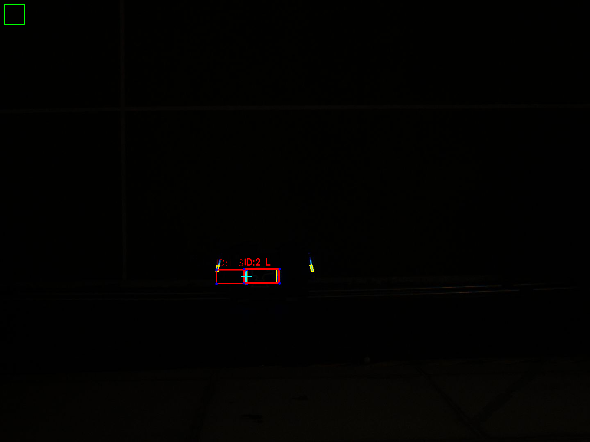

# 17 · 纯白掩膜兜底 + 蓝色阈值补齐

- **版本**：`detection_node_v3.cpp`
- **编译**：`BUILD EXIT: 0`

## 纯白掩膜兜底（white fallback）

触发位置：颜色/高亮掩膜没有配对成功（进入 `targets.empty()` 分支）时。

```cpp
cv::inRange(hsv_full, Scalar(0,0,240), Scalar(180,30,255), white_mask); // V>240 && S<30
findContours(white_mask, ...);
// 面积 >= 500，长宽比 1.3~6.0
// 恰好 2 条 -> 当左右灯条，送入模块3校验：
//   dx(15~300)、dy<=60、倾角差<12°、corrected/长边 ∈ [0.4,2.5]
// 通过 -> 黄框 + 红框 + "[WHITE] ID:x L/S"，继承上一帧 ID/大小板
```

可调参数：`white_v_min`、`white_s_max`、`white_area_min`、`white_aspect_min/max`。

## 蓝色阈值补齐

原来蓝色固定为 H 110~130、S/V 由 `hsv_sv_min`（100）控制，blue 包完全检不到。
现改成独立参数：

```cpp
blue_h_min = 100;  blue_h_max = 140;
blue_s_min = 50;   blue_v_min = 50;
```

## 实测

| bag | 检测次数 | 说明 |
|---|---|---|
| red_4 | 30 次 / 30s | 正常 |
| **blue_guard** | **42 次 / 45s** | 改阈值前是 **0 次** |
| blue_guard（白场兜底） | 0 | 这段没有纯白连片 |

白场分支本身跑到过 49 次（临时诊断日志 `[WHITE] raw=... pass=0 wmax=0~8`），
但这段夜景里 `V>240 && S<30` 的像素几乎不存在（最大白斑 8px），
所以“恰好两条纯白轮廓”的条件无法成立，`[WHITE]` 补位没有触发。



## 已知限制

1. 白场兜底写在 `if (!colored.empty())` 内部：如果颜色掩膜整张为空，白场分支不会执行。
   若要在“全黑/全白”极端场景生效，需要把它提到颜色判断之外。
2. 白场阈值是为“近战过曝的白芯”设计的（V>240、S<30）；夜景里灯条是橙色高饱和，
   不会进白场掩膜。
3. 蓝色包画面极暗，能检出但同一块板会出现两个重叠红框（去重半径 60px 不够）。

---

## 后续：白场改为默认关闭 + 参数污染排查

- 白场兜底属于极端场景，已用 `~white_enable`（默认 `false`）包起来：
  需要时 `_white_enable:=true` 即可，不用改代码。
- **重要排查**：测试中出现“检测突然全 0”，原因不是代码，而是 **ROS master 里残留了
  上一次实验的 private 参数**（`/robot_vision_node_v3/hsv_sv_min=200`、
  `yellow_s_min=200`、`bar_v_min=120`、`aspect 1.5~8.0`）。
  新节点启动会优先读这些持久化参数，导致黄色掩膜几乎为空。
  解决：启动前 `rosparam delete /robot_vision_node_v3`，或显式传全套参数。
- 清理后同参数复测：`ok=429`、检测 17 次/18s、异常 0。

---

## 蓝色包调参记录

- 蓝色 HSV 放宽为 `H 100~140 / S≥50 / V≥50` 后，blue_guard 从 0 检测变为
  39 次/40s（0 异常）。
- 蓝色包画面极暗，只有灯条发光；同一组灯条曾出现两个重叠红框，
  把目标去重半径从 60px 提到 **120px** 后，重叠框被拆成两个独立框。
- 复测：24 次检测/25s，异常 0。
