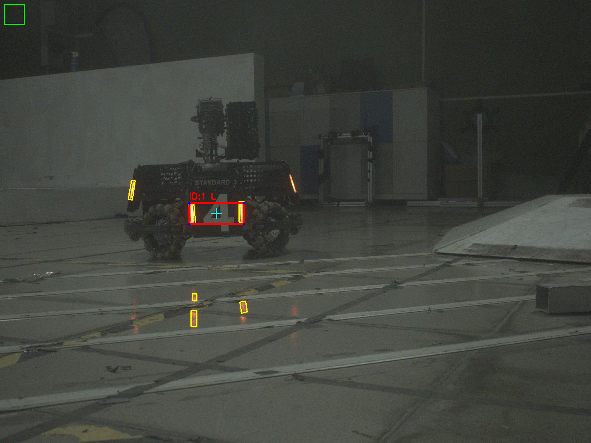

# 18 · 近战自适应 + 边缘门控 + 断笔合并

## 参数/逻辑

| 项 | 实现 |
|---|---|
| 近战自适应 | 最大颜色轮廓面积 > `~near_area`(默认 3000) 时，用 S/V=30 重新分割并 OR 回颜色掩膜，日志 `[Near]` |
| 长宽比 | 下限 2.0 → **1.3**，上限保持 6.0 |
| 距离拦截 | 上限 300 → **500**（下限仍 15） |
| 边缘门控 | `Canny + SobelX` 生成边缘掩膜，与颜色 `seg_mask` 做 `bitwise_and`；参数 `~edge_fuse`，**默认关闭** |
| 断笔合并 | 共线（x 差<18px）、高度相近、竖直间隙 <0.6 倍高的两根灯条合并成一个 RotatedRect；`~merge_bars` 默认开启 |

## 实测（red_4，23 帧统计）

| 指标 | 结果 |
|---|---|
| 无框帧 | 3 |
| 单框帧 | 14 |
| 多框帧 | 6 |
| 单目标画面 | 正常：`ID:1 L` 一个红框，灯条完整 |
| 异常 | 0 |

边缘门控打开时检测次数与关闭接近（22/22s vs 28/30s），没有明显增益，默认关闭。
近战重分割在现有数据里**未触发**（最大颜色轮廓始终 < 3000），代码保留、参数可调。

