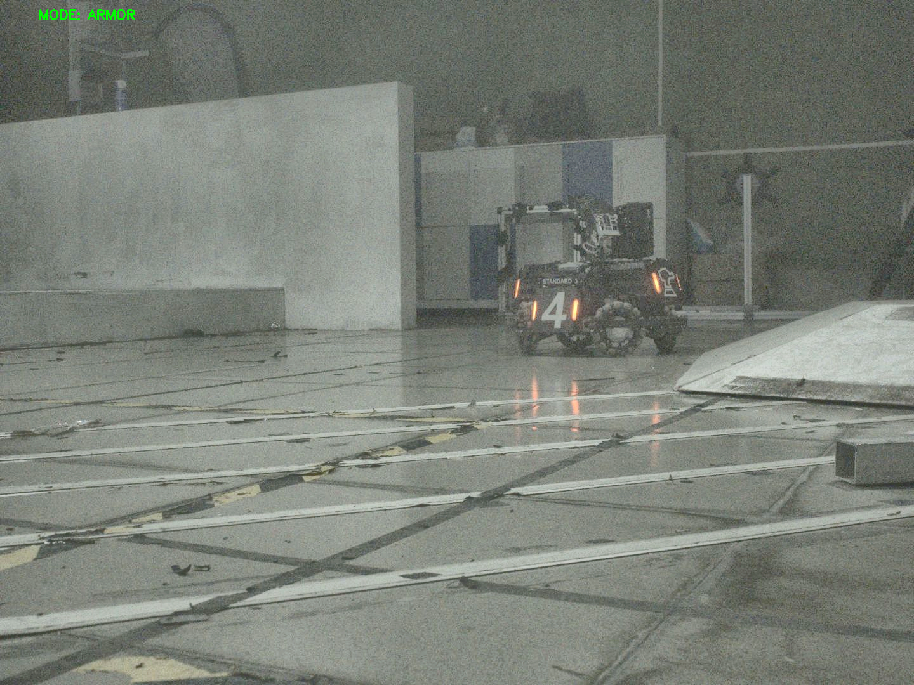

# 19 · v4 双模块架构（平A / 大招）实验

- 新文件：`src/detection_node_v4.cpp`（v3 仍为默认稳定版本）
- 编译目标：`detect_node_v4`，launch：`launch/test_v4.launch`
- 结构：
  - `Preprocessor`：CLAHE(LAB) + 自适应 Gamma + 饱和度拉伸 + Canny/高光/颜色融合掩膜
  - `NormalArmorDetector`：动态 ROI、质心、透视比例、极值框、PnP、Alpha-Beta
  - `EnergyRuneDetector`：高亮轮廓 + 最小二乘圆拟合 + PLL 相位
  - `VisionNodeV4`：模式订阅 `/vision_mode`，发布 `/ft/armor_pose`、`/ft/armor_velocity`

## 编译与运行

```
BUILD EXIT: 0
Built target detect_node_v4
ok=511, 异常 0
/ft/debug/image_v4 约 24 Hz
```

位姿样本（正常帧）：
```
x=-0.331  y=0.102  z=2.149
x=-0.296  y=0.098  z=2.141
```

## 问题（未解决，故不设默认）

约一半帧会发布 `(0, 0, 0.03)` 这类坏位姿；已加 `t[2] ∈ (0.3, 20)` 发布前校验仍未拦住，
根因未定位（怀疑与模式分支/多目标状态残留有关）。因此：

- **默认仍使用 v3**（`detect_node_v3`）；
- v4 仅作为实验目标，便于后续继续排查双模块架构。


